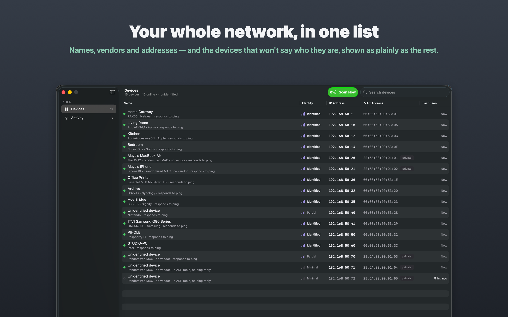
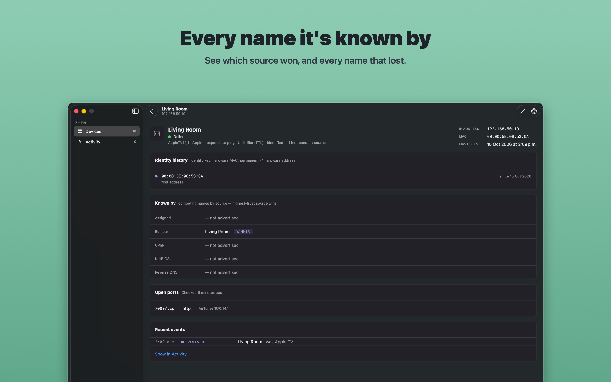

# Zhen

A fast, native network scanner for the Mac: every device on your network, named — or
honestly unnamed. The macOS app for [zhen-core](https://github.com/zhen-swift/zhen-core).

<!-- Artwork: generated by `bundle exec fastlane screenshots` from an invented network,
     never a real one (Docs/SCREENSHOTS.md). Re-render, don't edit. -->





## What it does

| | |
|---|---|
| **Devices** | Every device that answered, in one sortable, searchable table. Names, vendors, addresses, MACs, and how sure the name is. A device with a private Wi-Fi address and no name is a normal row, never an error |
| **Live scan** | Hosts stream in as they reply, with discovery, naming and the optional port stage shown as they run. Stopping keeps everything found so far |
| **Device detail** | Every name each source offered, and which won; the identity's history; open ports; recent events. Rename a device locally, or check its ports |
| **Activity** | Arrivals, departures, renames, merges and address moves over 48 hours, filtered by kind, with an hourly histogram that follows the filter |
| **Honest partial results** | A scan that lost a source, ran out of time or was stopped says so, on the scan and on the list afterwards, with the step that would help |
| **No root required** | Everything works unprivileged. An optional helper adds the layer-2 ARP sweep and SYN scans; it installs and removes from Settings, and is registered to appear in Login Items as Zhen |
| **One history** | The app and the `zhen` command line share one history file. A scan in a terminal shows up in the open window |

Requires macOS 26. Distributed with Developer ID, notarised, outside the Mac App Store
(`Docs/APP_STORE.md`). Zhen collects nothing (`Docs/PRIVACY.md`).

## Building

You need macOS 26, Xcode 26, and Ruby 4.0 with Bundler for the fastlane lanes.

```
bundle config set --local path vendor/bundle && bundle install   # once
bundle exec fastlane test               # unit + UI tests, signed ad hoc: no team needed
open Zhen.xcodeproj                     # the Zhen scheme; pick your own team under Signing
Scripts/release.sh - --no-notarize      # an ad-hoc release build with the helper embedded
```

The lanes sign ad hoc, so they work in a fork with no Apple Developer account. Running
from Xcode uses automatic signing, which needs a team of your own selected on the Zhen
target. `CONTRIBUTING.md` has the rest.

The app depends on the engine by version, never by path (`Package.resolved` pins
zhen-core 0.7.0). A version is a promise the engine has to keep on purpose.

## Documentation

| | |
|---|---|
| `AGENTS.md` | The house rules: how the app is written |
| `Docs/ARCHITECTURE.md` | How it fits together, and its known rough edges |
| `Zhen/Zhen.docc` | The design system as DocC — `bundle exec fastlane docc` |
| `Docs/TESTING.md` · `Docs/CI.md` · `Docs/SCREENSHOTS.md` | Tests, CI, and the artwork pipeline |
| `Docs/APP_STORE.md` · `Docs/PRIVACY.md` | Distribution, and what the app does with what it sees |

## History

The app and the engine began in one repository and were split on 2026-10-03; the app was
then rebuilt from zero, from 2026-10-07, on the design system documented in
`Zhen/Zhen.docc`.

## Licence

Apache License 2.0. See `LICENSE` and `NOTICE`.
